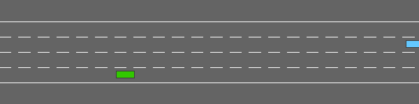

# RL-project-Racetrack
A continuous control task involving lane-keeping and obstacle avoidance.
# Autonomous Driving on a Racetrack with Reinforcement Learning

<p align="center">
  
</p>

Training an autonomous agent to drive on a racetrack, keeping its lane and avoiding other vehicles, using deep reinforcement learning on the [HighwayEnv](https://github.com/Farama-Foundation/HighwayEnv) `racetrack-v0` environment.

> Final project of the Reinforcement Learning course – EFREI Paris · Team of 2: [Amira Boudaoud, Ghofrane Ben Rhaiem]

---

## Problem

The agent controls the **steering** of a car on a closed circuit. It must:
- follow the track and stay in its lane,
- avoid collisions with other vehicles,
- drive as long as possible without leaving the road.

| | |
|---|---|
| **Environment** | `racetrack-v0` (HighwayEnv, Gymnasium) |
| **Action space** | Continuous – steering angle in [-1, 1] |
| **Observation space** | Occupancy grid (2 × 12 × 12) around the vehicle |
| **Reward** | Lane centering + on-road bonus, penalty on collision |

## Approach

We trained and compared **[at least two]** RL algorithms:

| Algorithm | Type | Implementation |
|---|---|---|
| **[PPO]** | On-policy, actor-critic | Stable-Baselines3 |
| **[SAC]** | Off-policy, maximum-entropy | Stable-Baselines3 |

For each algorithm we explored key hyperparameters ([learning rate, network size, discount factor γ, …]) and monitored training with TensorBoard.

## Repository structure

```
8_Final_Project_student.ipynb   # Environment exploration, training and evaluation
```

## Run it

```bash
pip install gymnasium highway-env "stable-baselines3[extra]" pygame
jupyter notebook 8_Final_Project_student.ipynb
```

The notebook runs end-to-end (also on Google Colab).

## Tech stack

Python · Gymnasium · HighwayEnv · Stable-Baselines3 · PyTorch · TensorBoard
